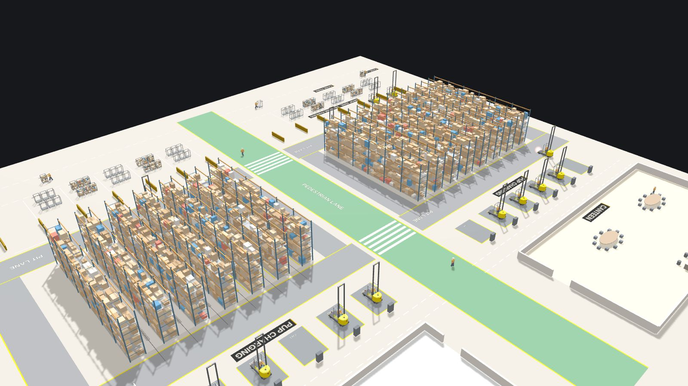

# Pick Quest

**A real-time 3D warehouse picking simulator.** Three PUP pickers work one-way aisles, lift to the right rack level, fill roll cages, reverse into the drop zone for a cage swap and return to charge, with game-style missions, scores and a shift dashboard.

Part of the **Quest Series**, a set of game-inspired 3D pieces by Kavya Suthan.

**▶ Live demo:** `https://<your-github-username>.github.io/pick-quest/`



## What it shows

- **A real pick floor layout**, designed from my own hand-drawn sketches. Modes A, B and C, 13 one-way wire-guided aisles, racking with levels A to D, pit lanes, a pedestrian lane, PUP charging bays, a drop zone with reverse parking, and a cage park.
- **Three pickers working at once**, each on its own serpentine route. Each picker:
  - lifts its platform to the correct level and reaches into the correct rack face
  - drops items into its roll cage (24 items per mission)
  - sounds the horn before leaving every aisle
- **Real operating rules.** Aisles are one-way, red drive lights come on only in the pit lane, PUPs reverse into the drop zone, and workers swap full cages for empty ones.
- **Missions and HUD.** A live objective and target location (for example `B600 · Bay 201 · Level C`), distance, a progress bar, a 3D waypoint, notifications, a battery meter and a shift dashboard with units per hour.
- **Cinematic mode.** An auto-directed six-scene sequence: the fulfilment floor, picking, cage filling, drop-off, charging and the final overview.
- **Sound.** Motor hum, reverse beeper, lift hydraulics, scanner beeps, cage rattle and the horn, all synthesised in code with the Web Audio API.
- **Two looks.** Smooth 3D, or a classic arcade style with scanlines and a high score.

## Controls

| Control | What it does |
| --- | --- |
| Drag / right-drag / scroll | Orbit, pan and zoom (pinch on touch screens) |
| Camera buttons | Follow the picker from above or in 3D, whole floor, aerial, each mode, charging, cage park |
| Picker | Switch between the Mode B, A and C pickers |
| Speed | 1×, 2× or 4× |
| Sound | Turn sound effects on or off (off by default) |
| Style | Smooth or Arcade |
| Dashboard | Shift summary: items, cages, missions, units per hour |
| Cinematic | Auto-directed film with letterboxing and captions |
| Background | Silent, panel-free version for use as a website backdrop |

**Direct links:** add `#cinematic` or `#background` to the page address to open in that mode. Add `?embed` to hide the "Explore" button when embedding the page in an iframe.

## Recording a video

Open the live demo in Chrome, choose **Cinematic**, then **Record video**. When Chrome asks what to share, pick **This tab** and turn on **Share tab audio**. Press **R** or **Esc** to stop early, then choose **Save video**.

## How it was built

I designed the floor plan, operating rules and missions from my own sketches and experience, and built the project in stages with AI (Claude) writing the code:

1. Layout blockout from the sketches
2. Detailed models: the PUP with its lifting platform, roll cages, racking and workers
3. Animation: three pickers on real routes, lifts, picks and cage swaps
4. Missions, HUD, notifications and the shift dashboard
5. Cinematic camera, sound effects and in-browser recording

**Tech:** [Three.js](https://threejs.org) r147 (WebGL), Web Audio API, MediaRecorder, plain HTML, CSS and JavaScript. No build step: everything is in `index.html`.

## Run it locally

Download the repository and open `index.html` in a modern browser (an internet connection is needed for the 3D library and fonts). Or serve the folder with:

```bash
python -m http.server 8000
```

then open `http://localhost:8000`.

## Note

Pick Quest shows a fictional fulfilment centre. It uses no real site data, company branding or operational details.
